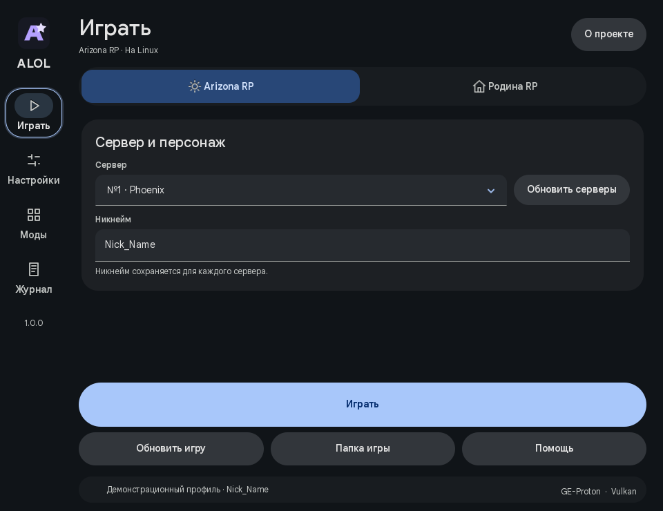
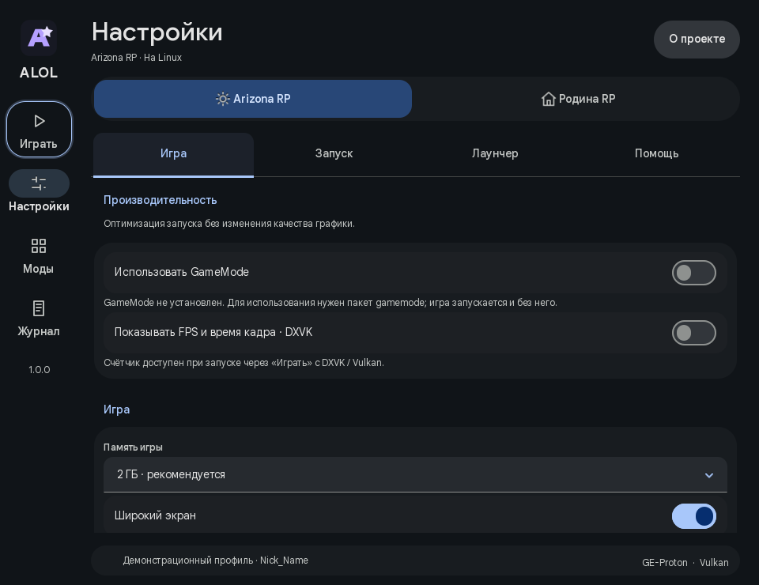
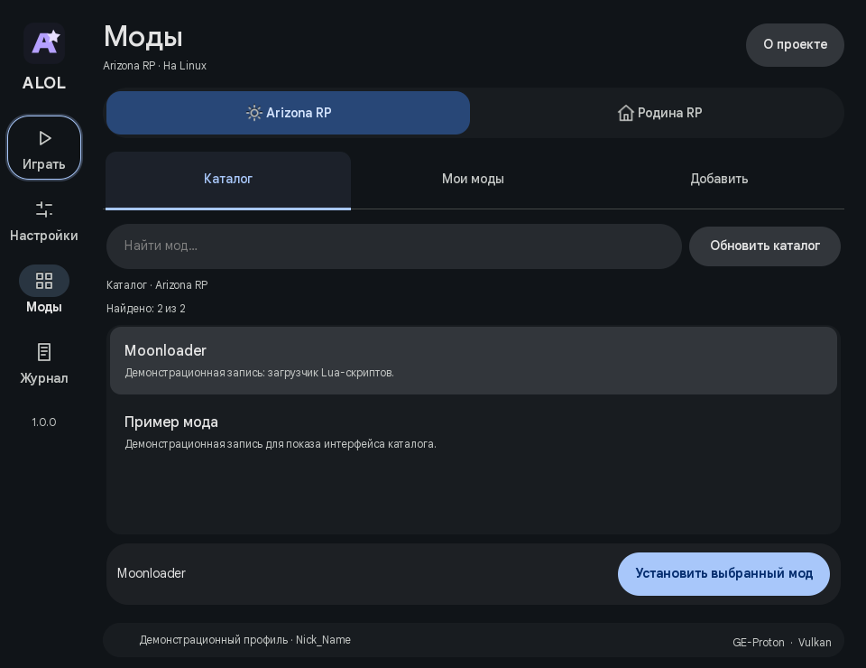

<!-- Project documentation for ALOL 1.0.0. -->
<div align="center">


<h1>ALOL — Arizona RP и Родина RP на Linux</h1>

<p>Arizona Launcher On Linux</p>
<p><a href="README_EN.md">English</a> · <a href="https://velmi1337.github.io/ru/alol/">Страница проекта</a></p>
<p>Первый стабильный релиз 1.0.0 · нативный лаунчер на Rust и GTK 3 с интерфейсом Material 3 Expressive (MD3E).</p>

<p>
  <a href="https://github.com/Velmi1337/ALOL/releases/latest"><strong>Скачать</strong></a> ·
  <a href="docs/guide.md">Руководство</a> ·
  <a href="https://t.me/alolinux">Telegram</a> ·
  <a href="https://github.com/Velmi1337/ALOL/issues">Сообщить об ошибке</a>
</p>

</div>

**ALOL 1.0.0 — первый стабильный релиз.** Две игры в одном окне: **Arizona RP** и
**Родина RP**. Новый интерфейс **Material 3 Expressive**, светлая и тёмная темы,
управление модами и понятный журнал операций.

## Установка

Скачайте пакет из [последнего релиза](https://github.com/Velmi1337/ALOL/releases/latest)
и выполните команду в папке с ним. Поддерживается **x86_64**.

### Arch Linux / CachyOS

```sh
sudo pacman -U ./alol-1.0.0-1-x86_64.pkg.tar.zst
```

Нужны включённый `multilib` и подходящие 32/64-битные графические драйверы.

### Fedora 44+

```sh
sudo dnf install ./alol-1.0.0-1.fc44.x86_64.rpm
```

RPM установит Wine и winetricks. Системная русская локаль не требуется. GE-Proton доступен при установленном UMU.

Откройте **ALOL** в меню приложений или выполните `alol`.
[Другие способы установки и сборка из исходников →](docs/installation.md)

## Что умеет ALOL

- **Две игры** — переключение Arizona RP / Родина RP с отдельными серверами, настройками и модами.
- **MD3E** — Material 3 Expressive, Google Sans, светлая/тёмная тема и адаптивная навигация.
- **Запуск** — ники Arizona сохраняются по серверам; в Родине имя вводится внутри игры.
- **Готовое окружение** — Proton или Wine, автоматическая установка шрифтов и Visual C++.
- **Наш ALOL-Proton** — профиль Arizona и исправление индикатора EN/RU в одной готовой сборке: [подготовка и выбор](docs/proton.md).
- **Моды и настройки** — официальный каталог, свои файлы и архивы, параметры графики и памяти.
- **Починка** — исправление русского текста, ошибок шрифтов и окружения с резервными копиями.
- **Журнал** — поиск, фильтры ошибок, пауза, копирование и очистка.
- **Автор и сообщество** — [GitHub Velmi1337](https://github.com/Velmi1337), [сайт](https://velmi1337.github.io/) и [Telegram](https://t.me/alolinux) доступны в окне «О проекте».
- **Обновления ALOL** — фоновая проверка новых версий, установка и перезапуск из окна лаунчера.

## Первый запуск

1. Скачайте установщик с [сайта Arizona](https://arizona-rp.com/) и выберите `.exe` в ALOL.
2. Нажмите **«Установить Arizona»** и дождитесь подготовки окружения.
3. Нажмите **«Скачать игру»** и загрузите её через официальный лаунчер.
4. Закройте официальный лаунчер, выберите игру и сервер, затем нажмите **«Играть»**.
   Для Arizona укажите ник в ALOL; для Родины он вводится внутри игры.

Дальше игра запускается прямо из ALOL. Официальный лаунчер используется для
загрузки, обновления и проверки файлов. Пароль аккаунта вводится в игре;
ALOL его не хранит.

<details>
<summary><strong>Скриншоты — главный экран, настройки и моды</strong></summary>

Снимки сделаны с демонстрационным профилем. Моды в каталоге — примеры для показа интерфейса.

### Главный экран



### Настройки



### Моды



</details>

## Новости проекта

> **ALOL в Telegram — [@alolinux](https://t.me/alolinux)**
>
> Новые версии, изменения и новости разработки — в канале проекта.
> [**Подписаться →**](https://t.me/alolinux)

## Contributors

- [Velmi1337](https://github.com/Velmi1337) — автор проекта, идеи и проверка на реальных системах.
- **Codex (OpenAI)** — ИИ-помощник в разработке, исправлениях и автоматических проверках.

## Подробнее

| Раздел | Что внутри |
| --- | --- |
| [Установка](docs/installation.md) | Пакеты, исходники и другие дистрибутивы |
| [Руководство](docs/guide.md) | Настройки, моды, починка и команды CLI |
| [Совместимость](docs/compatibility.md) | Wine, Proton и драйверы |
| [ALOL-Proton](docs/proton.md) | Экспериментальный пакет GE с профилем Arizona, подготовка и проверка |
| [Разработка](docs/development.md) | Сборка, проверки и публикация |
| [История изменений](CHANGELOG.md) | Что нового в ALOL |

## Лицензия

Код ALOL распространяется по [Apache License 2.0](LICENSE).
Copyright (c) 2026 ALOL contributors. Автор проекта — **Velmi1337**;
сведения об авторстве находятся также в [NOTICE](NOTICE).

При распространении копий или производных работ необходимо:

1. Включить полный текст лицензии Apache 2.0 из файла `LICENSE`.
2. Сохранить применимые уведомления об авторских и патентных правах,
   товарных знаках и авторстве в исходниках производной работы.
3. Сохранить применимые уведомления из `NOTICE`: в самом файле, документации
   или соответствующем разделе программы, как допускает раздел 4(d) лицензии.
4. В каждом изменённом файле оставить заметное уведомление о том, что он изменён.

Это краткое пояснение; точные условия приведены в разделе 4 файла `LICENSE`.
Ранее опубликованные теги и архивы, включая 0.5.7, сохраняют указанную в них MIT-лицензию;
старые релизные файлы не заменяются. Текст текущей лицензии и NOTICE доступен
также командой `alol --license`.

ALOL — независимый проект, не связанный с Arizona Games.
Игра и Windows-компоненты в пакет не входят.

Встроенный Google Sans распространяется отдельно под OFL-1.1; полная лицензия
и авторство включены в [NOTICE](NOTICE). Код ALOL остаётся Apache-2.0.
