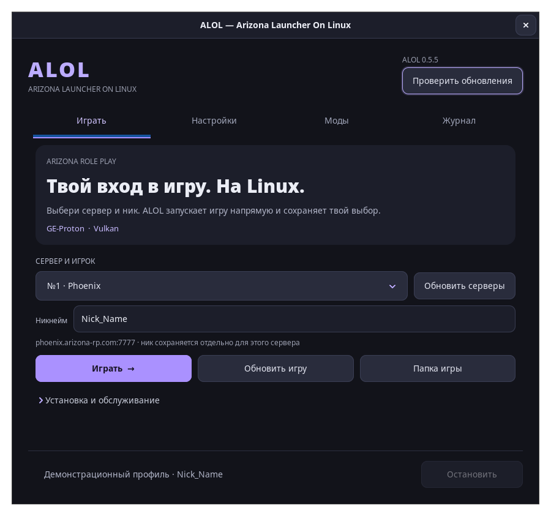

<!-- SPDX-License-Identifier: Apache-2.0 -->
<!-- English documentation for ALOL 1.0.1. -->
# ALOL — Arizona RP and Rodina RP on Linux

**Arizona Launcher On Linux. A native Rust and GTK 3 launcher.**

[Русский](README.md) · [Project website](https://velmi1337.github.io/alol/) · [Download](https://github.com/Velmi1337/ALOL/releases/latest) · [Report a problem](https://github.com/Velmi1337/ALOL/issues) · [Telegram](https://t.me/alolinux)

**ALOL 1.0.1 is a stable bugfix release.** It manages Arizona RP and Rodina RP environments on **Linux x86_64** through **Wine or Proton**.
A Material 3 Expressive (MD3E) interface brings light/dark themes, Google Sans, separate game settings, mod management and a searchable operation log.
Arizona nicknames are saved per server; Rodina asks for the name in-game.
It is an independent project and is not affiliated with Arizona Games. The game and Windows components are not bundled.



The screenshot uses a demonstration profile. It illustrates the interface, not a verified live game session.
The published interface screenshots are in Russian.

## Install

### AUR — Arch Linux / CachyOS

The **[alol](https://aur.archlinux.org/packages/alol)** package builds the stable
release from source:

```sh
yay -S alol
# or: paru -S alol
```

Enable `multilib` and install `base-devel`. Your AUR helper resolves the build
and runtime dependencies. Update with `yay -Syu` or `paru -Syu`.

Choose a package from the [latest GitHub release](https://github.com/Velmi1337/ALOL/releases/latest).
The commands below use the currently published `1.0.1` filenames; use the filename of the version you downloaded.

### Arch Linux / CachyOS

```sh
sudo pacman -U ./alol-1.0.1-1-x86_64.pkg.tar.zst
```

Enable `multilib` and install suitable 32-bit and 64-bit graphics drivers for your system.

### Fedora 44+

```sh
sudo dnf install ./alol-1.0.1-1.fc44.x86_64.rpm
```

The RPM installs its Wine and winetricks dependencies. A Russian system locale is not required.
GE-Proton is available with an installed UMU setup; consult the compatibility documentation for details.

Open **ALOL** from the application menu or run `alol`.
See [installation instructions](docs/installation.md) for alternatives and building from source.
The detailed guides currently use Russian.

## First launch

### Portable AppImage

For Linux x86_64 with glibc 2.35 or newer (Ubuntu 22.04+):

```sh
chmod +x alol-1.0.1-x86_64.AppImage
./alol-1.0.1-x86_64.AppImage
```

GTK libraries are bundled. Playing still requires UMU/Proton or Wine, winetricks,
curl and graphics drivers. Game files and Proton are not bundled. Without FUSE,
launch with `--appimage-extract-and-run`. In-app updates replace the whole AppImage.

## First game launch

1. Download the installer from the [official Arizona website](https://arizona-rp.com/).
2. Select the installer `.exe` in ALOL and choose the install action to prepare the environment.
3. Use the official launcher to download the game.
4. Close the official launcher, select the game and server, then launch from ALOL.
   Enter the nickname in ALOL for Arizona; Rodina uses its in-game character screen.

The official launcher remains responsible for game downloads, updates and file verification.
Your game-account password is entered in the game; ALOL does not store it.

## Features

- **Two games:** switch between Arizona RP and Rodina RP, with separate servers, settings and mods.
- **Material 3 Expressive:** adaptive navigation, Google Sans, light/dark themes and instant preference saving.
- **Game launch:** per-server Arizona nicknames; Rodina character naming stays in-game.
- **Environment:** documented Wine/Proton setup, fonts and Visual C++ preparation.
- **ALOL-Proton:** the Arizona launch profile and EN/RU indicator fix in one ready-to-download runtime; [setup](docs/proton.md).
- **Mods and options:** mod tools, custom files/archives, graphics and memory settings.
- **Repair:** fixes for common Russian-text, font and environment problems with backups.
- **Logs:** search, severity filters, pause, follow, copy and cleanup.
- **About:** links to [the author](https://github.com/Velmi1337), [website](https://velmi1337.github.io/) and [Telegram](https://t.me/alolinux).
- **Launcher updates:** release checking and the documented update/restart flow.

Compatibility depends on runtime, graphics drivers and distribution setup. Include those details when reporting a problem.

## Documentation and feedback

| Document | Contents |
| --- | --- |
| [Installation](docs/installation.md) | Packages, source builds and other distributions |
| [User guide](docs/guide.md) | Settings, mods, repair and CLI commands |
| [Compatibility](docs/compatibility.md) | Wine, Proton and graphics requirements |
| [Development](docs/development.md) | Build, checks and release process |
| [Changelog](CHANGELOG.md) | Published changes |

For a bug report, include the ALOL version, distribution, selected runtime, graphics setup,
steps you followed and the actual result. Report issues [on GitHub](https://github.com/Velmi1337/ALOL/issues).
News and release announcements are also available in the existing [@alolinux Telegram channel](https://t.me/alolinux).

## License and credits

Current development sources use **[Apache License 2.0](LICENSE)**.
Copyright (c) 2026 ALOL contributors. The project author and maintainer is **Velmi1337**.
The optional Wine patch remains LGPL-2.1-or-later, with complete corresponding source supplied in the runtime payload.
**Codex (OpenAI)** assisted with development and automated checks; see [NOTICE](NOTICE).

When distributing copies or derivative works, include the applicable license, preserve relevant notices,
retain applicable NOTICE attribution and identify modified files as required by Apache-2.0 section 4.
Read the license for its complete terms.

Previously published tags and archives, including **0.5.7**, retain their stated **MIT** license.
Old release assets are not replaced by documentation updates. Always check the license shipped with the version you use.

The bundled Google Sans font is separately licensed under OFL-1.1; its complete
license and attribution are included in [NOTICE](NOTICE). ALOL code remains Apache-2.0.
