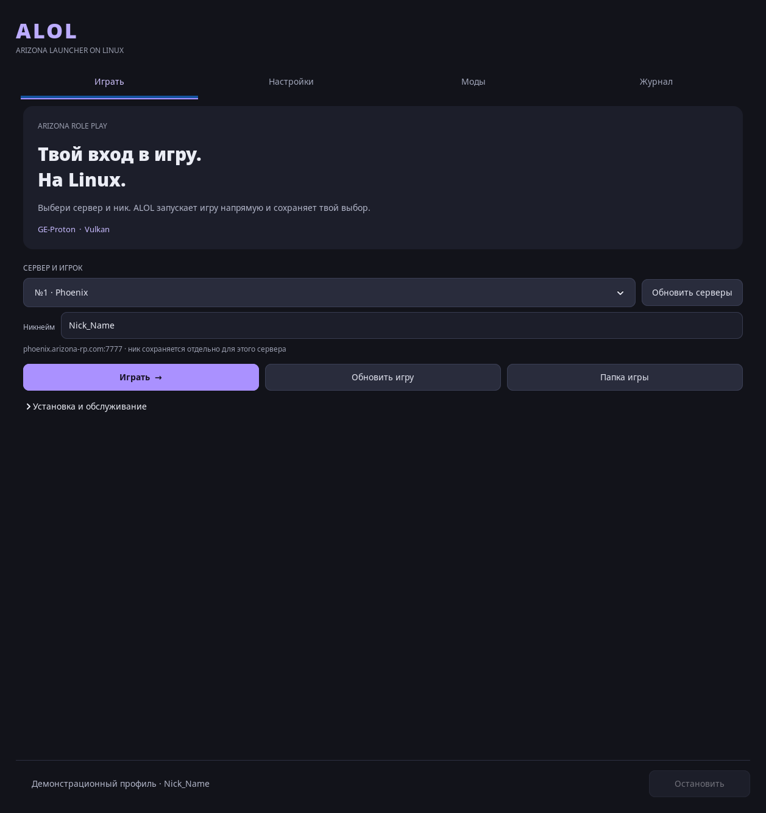
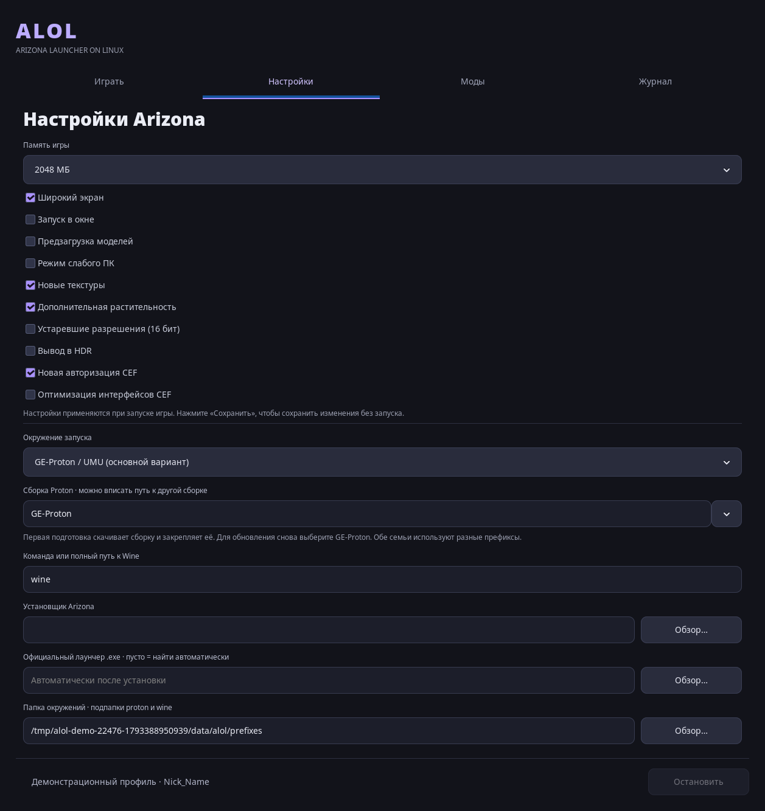
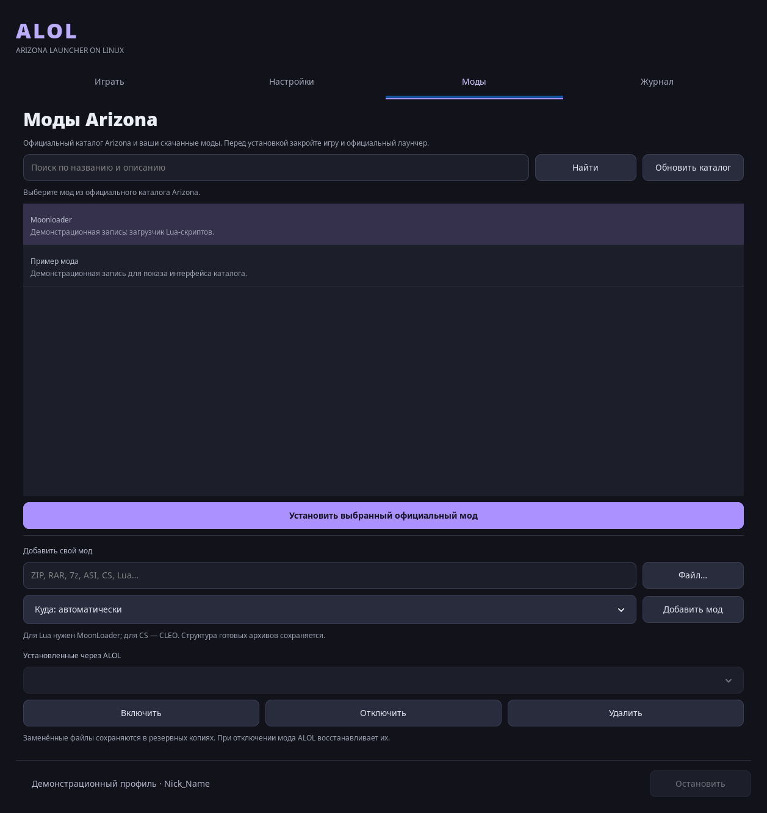

ALOL 0.5.2: аккуратные равные кнопки, симметричные вкладки и обновлённое оформление.
Добавлены реальные скриншоты из отдельного демонстрационного профиля.





ALOL — нативный лаунчер Arizona RP на Rust для Linux.

Для Arch Linux и CachyOS x86_64 скачайте `.pkg.tar.zst` и установите:

```sh
sudo pacman -U ./alol-0.5.2-1-x86_64.pkg.tar.zst
alol
```

Нужны включённый multilib и подходящие 32/64-битные графические драйверы.
Зависимости из репозиториев устанавливаются через pacman. Для первой загрузки
Proton, runtime и компонентов Windows нужен интернет.

Сборка и установка из исходников:

```sh
sudo pacman -S --needed base-devel rust python git
git clone https://github.com/Velmi1337/ALOL.git
cd ALOL
./install-arch.sh
```

`SHA256SUMS` содержит контрольные суммы пакета, исходников, PKGBUILD и трёх PNG.
В релиз не входят профили, префиксы, игровые файлы, логи, токены и домашние пути.
Поле автора пакета — `ALOL contributors`.

Возможности: выбор сервера и ника, игровые настройки Arizona, официальные и свои
моды, починка кодировки и файлов. Экспериментальный автопароль удалён.
Пароль вводится в игре. Проект не связан с Arizona Games.
